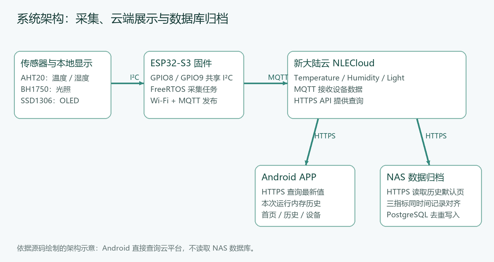
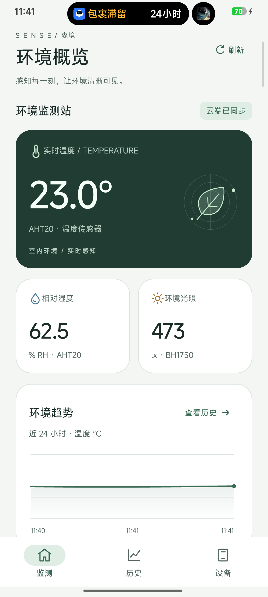
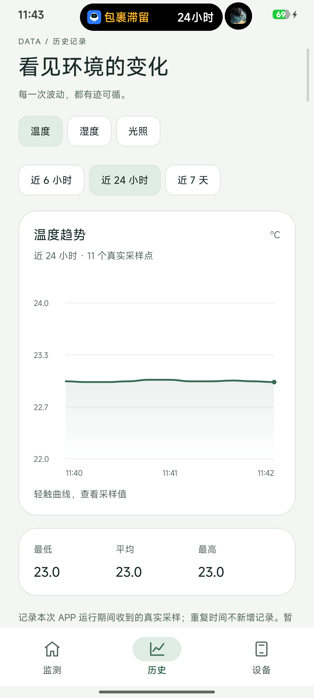
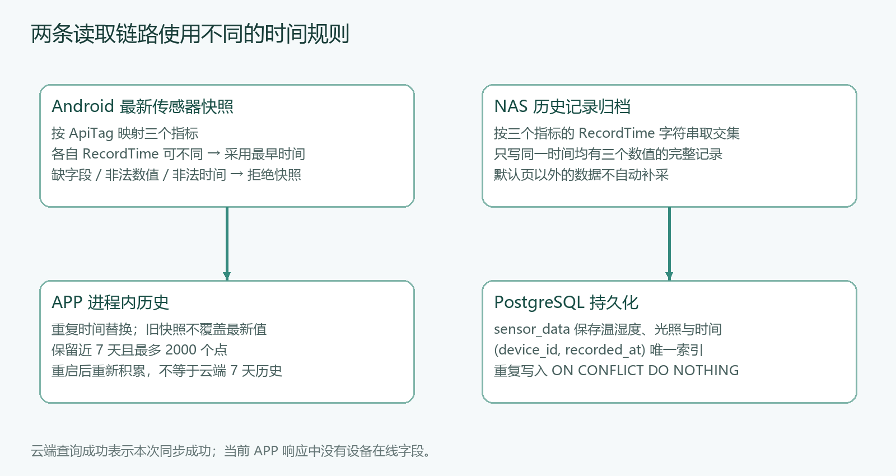

# 开源实战：基于 ESP32-S3 的多参数环境监测与物联网云平台设计

> 项目源码：[GitHub · esp32s3-environment-iot-system](https://github.com/1760hwy/esp32s3-environment-iot-system)。仓库包含 ESP32 固件、Android 工程、NAS 同步程序和本文配图。
>
> 本文适合已经接触过 ESP32、希望把“传感器读数”做成完整物联网项目的同学。代码来自实际开发工程，公开版本已将账号、设备配置与源码分开。

## 一、这个项目做了什么

单片机读到温度只是第一步。要让数据在手机上看得到、在数据库中查得到，还需要把采集、联网、云平台、移动端和数据归档接起来。

本项目的名字是“基于 ESP32-S3 的多参数环境监测与物联网云平台设计”。硬件侧用 AHT20 读取温湿度、BH1750 读取光照，用 SSD1306 OLED 显示当前读数；ESP32-S3 通过 Wi-Fi 连接新大陆云，使用 MQTT 上传。手机侧用 Java + XML 编写原生 Android APP，直接读取云平台的最新数据。NAS 上另有 Python 同步程序，把云端历史记录写入 PostgreSQL，便于后续查询。

这里的云平台使用新大陆云 NLECloud，本项目没有自建一个替代 NLECloud 的服务器。Android 查询云平台，NAS 也查询云平台，APP 当前没有连接 PostgreSQL。这一点先说清楚，读代码时就不会把两条链路混在一起。



图中箭头表示主要数据流向，Android 和 NAS 通过 HTTPS 主动查询云平台。该图依据源码绘制，是架构示意，不是运行抓包或部署截图。

| 部分 | 技术与作用 | 主要目录 |
|---|---|---|
| 采集端 | ESP32-S3、ESP-IDF、FreeRTOS、I²C | `firmware/` |
| 本地显示 | SSD1306 128×64 OLED | `firmware/main/BSP/ss1306/` |
| 云端接入 | Wi-Fi、MQTT、NLECloud | `firmware/main/BSP/network/` |
| 手机展示 | Java、XML、ViewModel、原生 Canvas | `android/` |
| 数据归档 | Python、Docker Compose、PostgreSQL | `server/` |

## 二、先看手机端效果

APP 包括监测、历史、设备三个页面。监测页展示温度、湿度、光照与云端同步状态；历史页可以切换指标与时间范围；设备页可以调整刷新间隔、暂停自动同步和切换主题。



这是 2026-10-23 保存的真实 Android 手机截图，原图保留系统状态区域。画面中的数值是当时的样本，不是固定初始值，也不是传感器精度或长期稳定性的测量结论。



历史页有一个容易误解的地方：选择“近 7 天”，表示筛选本次 APP 运行期间已经收到的数据，**不表示已经从云端下载了 7 天历史**。APP 重启后会重新积累；PostgreSQL 的持久化归档是另一条独立链路。

## 三、硬件准备与接线

需要 ESP32-S3 开发板、AHT20 模块、BH1750 模块、I²C SSD1306 128×64 OLED、数据 USB 线和杜邦线。具体开发板型号没有在工程中固定，接线前先确认 GPIO8、GPIO9 在自己的板上可用，没有被其他板载外设占用。


这是接线示意图，不是实物照片。断电接线，确认各模块支持 3.3 V 供电和信号电平后再上电。

| ESP32-S3 | AHT20 | BH1750 | SSD1306 |
|---|---|---|---|
| 3V3 | VCC/VIN | VCC/VIN | VCC/VIN |
| GND | GND | GND | GND |
| GPIO8 | SDA | SDA | SDA |
| GPIO9 | SCL | SCL | SCL |
| 地址 | `0x38` | `0x23`，ADDR 为低 | `0x3C` |

I²C 允许多个不同地址的器件共用 SDA 和 SCL。本工程只在 `bsp_i2c.c` 建立一条总线，三个驱动复用 `bsp_i2c_get_handle()`，不分别创建重复总线。新驱动使用总线与设备分离的模型，详见 [ESP-IDF v6.1 I²C 官方文档](https://docs.espressif.com/projects/esp-idf/en/release-v6.1/esp32s3/api-reference/peripherals/i2c.html)。

模块自带上拉、电线长度、供电与共地都会影响通信；代码开启内部上拉不等于所有接线条件都已经满足。读不到设备时先核对电气连接、地址和上拉，再检查软件。

## 四、下载代码并准备开发环境

```powershell
git clone https://github.com/1760hwy/esp32s3-environment-iot-system.git
cd esp32s3-environment-iot-system
```

仓库是独立发布副本，不包含原始开发目录里的压缩包、密钥、IDE 缓存、数据库数据或带账号的二进制。

| 环境 | 工程基线 / 前提 |
|---|---|
| 固件 | ESP-IDF v6.1，目标 `esp32s3` |
| 外部固件组件 | 锁文件记录 MQTT 1.1.0、esp_type_utils 1.2.7，由 Component Manager 获取 |
| Android | AGP 9.4.1、Gradle 9.6.0、compileSdk / targetSdk 37、minSdk 24 |
| Java | Java 源码兼容级别 11；Gradle daemon 工具链声明为 Java 25 |
| 同步容器 | Dockerfile 使用 `python:3.12-slim` |
| Python 库 | `requests>=2.32,<3`、`psycopg[binary]>=3.2,<4` |
| 数据库 | 需要自行准备可访问的 PostgreSQL、数据库和写入账号 |

这些是源码与构建文件记录的基线，不代表“必须升级到最新版本”。不要为了跟教程先改 SDK 或依赖版本；先按现有锁文件完成复现。Android 首次构建需要能获取对应工具与依赖，`--offline` 仅适用于已具备完整缓存的环境。

## 五、先在新大陆云建立设备与字段

在自己的新大陆云账户中创建项目和支持 MQTT 接入的设备，记录平台提供的设备编号、设备标识及设备密钥。各平台页面可能调整，填写含义以自己的设备详情为准。

建立三个数值型传感器，接口标识严格使用：

| 含义 | ApiTag | 单位 |
|---|---|---|
| 温度 | `Temperature` | °C |
| 相对湿度 | `Humidity` | % RH |
| 光照 | `Light` | lx |

显示名称可以自行命名，代码匹配的是 ApiTag，大小写需一致。固件、APP 和同步端使用同一组标识，能减少字段错位。

当前固件拼接的发布主题为：

```text
/sys/<设备编号>/<设备标识>/sensor/datas
```

主题中的值要对应自己在云平台创建的设备。MQTT 的设备密钥与 Android / NAS 使用的账户密码属于不同配置，不能互相替代。

下面仅演示报文格式，数值是示例，不是测试数据：

```json
{
  "datatype": 1,
  "datas": {
    "Temperature": 23.0,
    "Humidity": 62.5,
    "Light": 473.0
  }
}
```

`app_mqtt_publish_environment()` 负责把三个浮点值组装为 JSON，检查缓冲区长度，再以 QoS 1 发布。函数返回成功说明发布请求被 MQTT 客户端接受，最终是否产生新的云端记录仍要到平台检查，不能只看 `msg_id`。

## 六、配置与构建 ESP32-S3 固件

### 6.1 填自己的私有配置

仓库根目录执行：

```powershell
Copy-Item firmware/main/app_secrets.example.h firmware/main/app_secrets.h
```

打开 `app_secrets.h`，填写自己的 Wi-Fi SSID、Wi-Fi 密码、设备编号、设备标识和设备密钥。模板中的 `YOUR_...` 是占位符。

`app_secrets.h` 已被 Git 忽略，但真实编译出来的固件仍可能包含配置，所以不要把带密钥的 BIN、ELF 当作无敏感信息的附件上传。

### 6.2 构建与烧录

在已激活 ESP-IDF v6.1 的 PowerShell 中执行；工作目录是仓库内的 `firmware`：

```powershell
cd firmware
idf.py --version
idf.py set-target esp32s3
idf.py build
```

首次构建会获取清单中的组件。构建完成应看到 `Project build complete` 并生成对应 ELF / BIN。构建失败时先查看首条有效错误：私有配置是否存在、工具链是否激活、组件是否下载完整，而不是直接改驱动。

确认接线和配置后，由读者把下面的 `COMx` 换成自己的串口再烧录；该步骤会写入所连接的 ESP32：

```powershell
idf.py -p COMx flash monitor
```

串口中应能观察 Wi-Fi 获得地址、MQTT 连接和温湿度 / 光照日志；OLED 应更新三个值，云端三个字段的记录时间应推进。三处需要分别检查，编译成功本身不证明硬件和云端可用。

### 6.3 固件入口与任务结构

完整实现见仓库 [`firmware/main/main.c`](https://github.com/1760hwy/esp32s3-environment-iot-system/blob/main/firmware/main/main.c)。`app_main()` 依次初始化 Wi-Fi、I²C、MQTT、显示与传感器，然后创建 `environment_task`，任务栈大小参数为 6144、优先级为 5。

采集任务循环完成四件事：读取 AHT20，更新温湿度显示；读取 BH1750，更新光照显示；只有两次采集都成功才上传三项数据；延时后进入下一轮。当前源码保留两个 1000 ms 的等待点，再加上传感器和调度开销，不能把周期写成严格 1 秒。

如果读取失败，会打印错误并跳过该轮整体上传。AHT20 驱动还检查 I²C 返回值、忙状态轮询上限、CRC 与解码范围，失败时保留上次有效数值。CRC 或边界检查只能保护报文解析，不能替代传感器校准。

## 七、配置与运行 Android APP

Android 工程在 `android/`。使用 Android Studio 打开这一层目录，完成 Gradle 同步，并准备构建文件要求的 SDK。它是可编译的 Java/XML 原生工程，图表使用自定义 View 和 Canvas 绘制。

### 7.1 本地账户配置

仓库根目录执行：

```powershell
Copy-Item android/cloud.properties.example android/cloud.properties
```

在新文件填写自己的 `NLE_ACCOUNT`、`NLE_PASSWORD` 和 `NLE_DEVICE_ID`。这里的设备编号应与固件上传目标一致。该文件按 Java Properties 格式读取，特殊字符按该格式转义。

发布副本把原来写在 Activity 中的开发账户移到本地配置，构建时生成 BuildConfig。这个做法用于避免误提交，不是加密方案；APK 仍能被分析出这些值。对外分发成品 APP 时，需要另外设计服务端鉴权，不能把个人云账户共享给所有用户。

### 7.2 构建和检查

在 `android/` 目录，用本机 JDK / Android Studio 工具链执行：

```powershell
.\gradlew.bat :app:assembleDebug :app:testDebugUnitTest :app:lintDebug --no-configuration-cache --console=plain
```

Linux / macOS 使用 `sh ./gradlew` 执行相同任务。Debug APK 位于 `app/build/outputs/apk/debug/app-debug.apk`。先构建成功，再安装到自己的设备，观察是否能获取新记录。

### 7.3 数据如何进入三个页面

```text
MainActivity.configureCloud()
  → NleCloudSource：登录、内存缓存 token、查询传感器
  → NleCloudApi：HTTPS 请求与平台响应校验
  → NleSensorMapper：ApiTag / Value / RecordTime 映射
  → MonitorViewModel：后台请求、主线程更新与轮询调度
  → 首页 / 历史页 / 设备页
```

启动后首次取数前显示占位符；失败保留最后一份真实数据与原采样时间，不回退到模拟值。虽然模型中保留了供测试、预览使用的示例方法，当前运行数据链路不加载模拟读数。

默认每次请求完成后等待 5 秒再同步，可以切换为 10 / 30 秒或暂停。退到后台停止后续轮询，已经发出的请求允许结束；返回前台按开关恢复。请求不重叠，避免慢网络下不断堆积。

## 八、把云端数据归档到 PostgreSQL

NAS 同步程序是独立组件。它调用云平台历史接口，不订阅 MQTT，也不从手机读取数据。`compose.yaml` 只启动同步程序，不自动创建 PostgreSQL 实例。

### 8.1 准备自己的数据库

先在 PostgreSQL 中创建数据库和专用账号，确保账号对目标 schema / 表 / identity sequence 有所需权限，再连接目标数据库执行仓库的 `server/schema.sql`。例如在已安装 `psql` 的机器，工作目录为 `server/`：

```powershell
# 把示例主机改为自己的数据库地址；按实际端口调整。
psql -h YOUR_DB_HOST -p 5432 -U iot_user -d iot_db -f schema.sql
```

也可以在 pgAdmin 的 Query Tool 中打开并执行同一 SQL。这里的建表文件是根据 `sync.py` 的 INSERT 字段补充的**最小复现结构**，不是原 NAS 数据库的完整导出，也不承担已有表的迁移。已有同名表时先检查字段类型、权限与重复记录。

| 字段 | 含义 |
|---|---|
| `device_id` | 同步脚本写入的 `DEVICE_NAME`，如 `esp32s3_001` |
| `temperature` | 温度，°C |
| `humidity` | 相对湿度，% |
| `light_lux` | 光照，lx |
| `recorded_at` | 带时区的采样时间 |

特别留意：表的 `device_id` 保存的是脚本配置的设备名称，并非自动保存云平台数字编号。更换 `DEVICE_NAME` 会影响去重维度，建立多设备归档时要保持标识稳定。

### 8.2 配置同步容器

在 `server/` 目录执行：

```powershell
Copy-Item config.env.example config.env
```

填写 `NLE_ACCOUNT`、`NLE_PASSWORD`、`DEVICE_ID`、`DEVICE_NAME`、`DB_HOST`、`DB_PORT`、`DB_NAME`、`DB_USER`、`DB_PASSWORD` 和 `POLL_SECONDS`。模板端口填的是常见示例 5432，原脚本无配置时默认 15432；实际值以数据库监听或映射端口为准。

在 NAS Linux 终端对应目录执行，或者使用 NAS 自带的 Compose 项目界面部署：

```bash
cp config.env.example config.env
# 首次部署前编辑 config.env；已有配置时不要覆盖。
docker compose build
docker compose up -d
docker compose logs --tail=50 -f
```

Windows 和 Linux 两段复制配置命令二选一，填写完成后不要再重复覆盖。`DB_HOST` 是从同步容器内部看得到的数据库地址，通常不能写成容器自身的 `localhost`。两个容器在同一 Docker 网络时可使用正确的服务名；独立 NAS 服务则用可达的 NAS 地址与数据库映射端口。

Compose 通过 `env_file` 传入环境变量，语义可查 [Docker 官方文档](https://docs.docker.com/compose/how-tos/environment-variables/set-environment-variables/)。这保留了原个人部署方式；环境文件仍须限制访问，生产环境可改用 secret 管理。

日志应关注 `NLE login successful`、`complete_rows=` 与 `new_rows=`。登录成功只证明登录接口成功，`complete_rows` 是本轮完整记录数，`new_rows` 才是新插入数量。重复轮询同一批数据时，`new_rows=0` 可以是正常去重结果。

### 8.3 用 SQL 检查归档结果

```sql
SELECT device_id, temperature, humidity, light_lux, recorded_at
FROM public.sensor_data
ORDER BY recorded_at DESC
LIMIT 20;

SELECT device_id, recorded_at, COUNT(*)
FROM public.sensor_data
GROUP BY device_id, recorded_at
HAVING COUNT(*) > 1;
```

第一条检查数值和时间是否更新，第二条检查是否有重复时间记录。脚本使用参数化 SQL，并对 `(device_id, recorded_at)` 建唯一索引，重复记录执行 `ON CONFLICT DO NOTHING`。该语句依赖对应唯一约束或索引，可参考 [PostgreSQL INSERT 文档](https://www.postgresql.org/docs/current/sql-insert.html)。

## 九、时间与历史：两个模块的规则不同



Android 使用最新传感器接口，按 ApiTag 映射三项数据，不依赖数组顺序。如果三项记录时间不同，快照取最早时间，避免把较旧指标标成最新。缺字段、空值、非法数值或非法时间会拒绝整份快照。历史按时间维护，重复时间替换，不让更早快照覆盖当前值，最多保留近 7 天、2000 个点。

NAS 使用历史记录接口，把三个指标的 RecordTime 取交集。**同一时间三项都有值才写一行**；时间不完全相同的记录不会自动合并。这与 Android 的“取最早时间”不是同一种规则。

两处都把没有时区的云端时间按 `Asia/Shanghai` 处理，这来自当前数据格式约定。如果更换数据源，应重新核实约定，避免时区转换造成错位。

此外，现有同步端只读取 API 默认页，没有分页、时间窗口补采和本地断点。所以 PostgreSQL 是已经同步记录的持久化存储，不能据此宣称永不丢数、断网自动补齐或已经长期完整归档。

## 十、建议按这个顺序验收

| 层次 | 观察什么 | 不能据此替代什么 |
|---|---|---|
| 构建 | 固件 `Project build complete`，Android `BUILD SUCCESSFUL` | 不能替代真机测试 |
| 传感器 | 串口三项读数合理，改变环境后有响应 | 不能替代精度标定 |
| OLED | 实物屏幕能看到并持续更新读数 | I²C ACK 不能替代可见显示 |
| 云平台 | 三个字段有新记录，采样时间持续推进 | MQTT 连接日志不能替代平台入库 |
| APP | 数值与云平台对应，刷新 / 暂停 / 失败提示正确 | HTTP 成功不代表 ESP32 在线 |
| 数据库 | 新行写入、时间正确、重复轮询不增加重复行 | 不代表默认页之外的数据完整 |

开发阶段已经保存 Android 构建、测试和真实手机画面。此次开源整理另对脱敏发布副本做构建与静态检查，结果见仓库 [VALIDATION.md](https://github.com/1760hwy/esp32s3-environment-iot-system/blob/main/docs/VALIDATION.md)。本文没有把既有截图当作今天新拍的截图，也没有在整理文档时重新烧录硬件或操作 NAS。

## 十一、常见问题

| 现象 | 先检查的内容 |
|---|---|
| I²C NACK / 传感器读取失败 | 共地、供电、GPIO8/9、器件地址、上拉、电线长度 |
| OLED 黑屏但串口正常 | 屏幕型号、128×64 配置、地址、供电与实际可见画面 |
| MQTT 已连接但云端没值 | 设备编号 / 标识、密钥、topic、ApiTag、报文格式、采集是否都成功 |
| APP 登录失败 | `cloud.properties` 是否填写、网络、账号密码与 API 响应 |
| APP 读取成功但数据不更新 | 云端 RecordTime 是否推进；重复记录不应伪造为新采样 |
| APP 近 7 天数据很少 | 当前是进程内历史，没有下载云端完整历史 |
| `ZoneInfoNotFoundError: Asia/Shanghai` | 为运行环境补充 IANA 时区数据库（系统 tzdata 或 Python tzdata 包），再启动同步；本次未构建容器核实基础镜像 |
| 容器连不上数据库 | 从容器看 DB_HOST 是否可达，端口、访问控制和账号权限是否正确 |
| `complete_rows=0` | 三个 ApiTag 是否都存在、RecordTime 是否完全相同、默认页内容是否符合预期 |
| `new_rows=0` | 先确认是否已经同步过同一批记录，再查写入权限和错误日志 |
| 唯一索引创建失败 | 先检查已有重复记录；不要直接删历史数据来“修复” |

## 十二、开源范围与后续改进

仓库保留了能对应到实际工程的代码入口，适合学习传感器驱动、共享 I²C、MQTT、原生 Android 数据绑定和 PostgreSQL 归档。当前没有设备远程控制、OTA、报警推送、多租户管理和 APP 数据库历史查询，这些可以作为后续扩展，不能写成现成功能。

如果继续完善，我会优先考虑云历史分页与补采、APP 历史持久化、设备在线状态来源、公共 APP 的服务端鉴权，以及 MQTT 加密。先解决数据完整性与权限边界，再增加更多界面。

自有代码和文档采用 MIT。SSD1306、BH1750 等保留原许可；AHT20 旧参考代码许可未确认，作为明确例外保留，**不属于本项目 MIT 授权范围**。因此不能把整个仓库宣传为“所有文件都是 MIT、可任意商用”。具体见仓库 [THIRD_PARTY.md](https://github.com/1760hwy/esp32s3-environment-iot-system/blob/main/THIRD_PARTY.md)。

完整源码与复现资料：[GitHub · ESP32-S3 多参数环境监测系统](https://github.com/1760hwy/esp32s3-environment-iot-system)。

固件接线与上云的早期入门版本：[ESP32-S3 新大陆云教程](https://github.com/1760hwy/esp32s3-nlecloud-environment-tutorial)。完整系统请以本文引用的新仓库为准。
